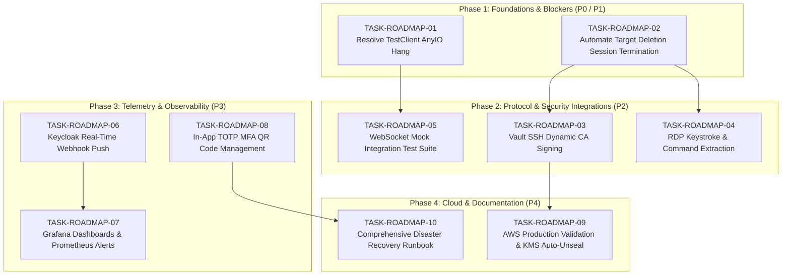

# SecurePAM — Dependency-Based Implementation Roadmap

**Audit Date:** 15 November 2026  
**Auditor Roles:** Senior Software Architect, Technical Lead & Project Planning Auditor  
**Scope:** Complete implementation plan for addressing all identified architectural, security, testing, and deployment gaps.  
**Standard:** Strict Dependency Ordering, Clear Acceptance Criteria, Test Requirements, and Complexity Estimates.

---

## 1. Roadmap Prioritization Framework

Tasks are prioritized using the following standard:
- **Priority 0 (P0): Critical Security & Blocker Fixes** — Immediate security hardening and deployment unblockers.
- **Priority 1 (P1): Core Functionality & Broken Workflows** — Essential protocol gateway and backend integration improvements.
- **Priority 2 (P2): Missing Integrations & Important Features** — Advanced enterprise capabilities (OCR, CA signing).
- **Priority 3 (P3): Testing, Telemetry & Reliability** — Automated load testing, Grafana dashboards, and test runner fixes.
- **Priority 4 (P4): Documentation & Operational Polish** — User guides, runbooks, and disaster recovery plans.

---

## 2. Dependency Graph & Execution Order

---

## 3. Detailed Task Specifications

### TASK-ROADMAP-01: Resolve Policy Engine API TestClient Compatibility
- **Task ID:** `TASK-ROADMAP-01`
- **Module:** Testing Infrastructure / Policy Engine
- **Priority:** **P1**
- **Estimated Complexity:** Low (1 Day)
- **Dependencies:** None (Independent)
- **Exact Requirement:** Update `policy-engine/tests/test_api.py` to use `httpx.AsyncClient` with `ASGITransport` instead of synchronous `starlette.testclient.TestClient`, eliminating the AnyIO portal deadlock on Windows.
- **Files Likely to be Modified:** `policy-engine/tests/test_api.py`.
- **Backend Changes:** Refactor 8 test functions from `def test_...` to `async def test_...`, wrapping `create_policy_router` in an `AsyncClient`.
- **Frontend Changes:** None.
- **Database Changes:** None.
- **Security Considerations:** Ensures all 101 policy engine tests run in automated regression pipelines without timing out.
- **Acceptance Criteria:** `pytest tests/test_api.py` executes and passes all 8 tests within 2 seconds.
- **Required Tests:** Execute all 8 tests in `policy-engine/tests/test_api.py`.

---

### TASK-ROADMAP-02: Automated Session Termination on Target Host Deletion
- **Task ID:** `TASK-ROADMAP-02`
- **Module:** Control Plane / Asset Management
- **Priority:** **P0**
- **Estimated Complexity:** Medium (1.5 Days)
- **Dependencies:** None (Independent)
- **Exact Requirement:** When an Asset or Application is soft-deleted or deactivated via `DELETE /api/v1/assets/{id}`, the backend must automatically identify all active sessions bound to that target and terminate them immediately through `session_termination_service`.
- **Files Likely to be Modified:** `backend/app/api/v1/assets.py`, `backend/app/api/v1/applications.py`, `backend/app/services/session_termination.py`.
- **Backend Changes:** Query active sessions associated with the target ID during delete operations, call `terminate_session(session_id, reason="TARGET_DECOMMISSIONED")`, and commit the transaction.
- **Frontend Changes:** Update asset deletion modal to warn operators if active sessions are currently connected.
- **Database Changes:** None.
- **Security Considerations:** Prevents orphaned privileged connections to decommissioned infrastructure.
- **Acceptance Criteria:** Deleting an active asset immediately terminates all associated live WebSocket tunnels.
- **Required Tests:** Unit test verifying deletion triggers session termination and writes `SESSION_TERMINATED` audit log.

---

### TASK-ROADMAP-03: Vault SSH Dynamic CA Signing Integration
- **Task ID:** `TASK-ROADMAP-03`
- **Module:** Secrets Management & SSH Gateway
- **Priority:** **P2**
- **Estimated Complexity:** High (3 Days)
- **Dependencies:** `TASK-ROADMAP-02`
- **Exact Requirement:** Extend OpenBao secret provider and SSH gateway to utilize Vault's SSH secrets engine (`ssh/issue/securepam-role`). Generate ephemeral, cryptographic client certificates valid for the exact JIT grant duration, removing static stored SSH passwords and keys.
- **Files Likely to be Modified:** `backend/app/secret_providers/openbao.py`, `backend/app/services/ssh_terminal_gateway.py`, `backend/app/models/asset.py`.
- **Backend Changes:** Add `issue_ssh_certificate(public_key, valid_duration)` in `openbao.py`; inject certificate into `asyncssh.connect(client_keys=[...])`.
- **Frontend Changes:** Add "SSH Certificate Authority" toggle in Asset creation modal.
- **Database Changes:** Add `auth_method` column to `assets` table (`Enum('PASSWORD', 'PRIVATE_KEY', 'VAULT_CA')`).
- **Security Considerations:** Eliminates static credentials from Linux servers; enforces zero-standing-privilege.
- **Acceptance Criteria:** Target Linux server authenticates operator via OpenBao-signed certificate; expired certificates are rejected.
- **Required Tests:** Pytest test suite mocking Vault SSH CA signing response and verifying key expiration.

---

### TASK-ROADMAP-04: RDP Keystroke & OCR Command Transcript Extraction
- **Task ID:** `TASK-ROADMAP-04`
- **Module:** Protocol Gateway (RDP) & Forensics
- **Priority:** **P2**
- **Estimated Complexity:** High (4 Days)
- **Dependencies:** None
- **Exact Requirement:** Implement server-side command and text extraction for RDP sessions, matching the capabilities of SSH asciicast transcripts. Intercept Guacamole keyboard input instructions (`key` instructions) or run background OCR analysis on recorded video frames.
- **Files Likely to be Modified:** `backend/app/services/rdp_gateway.py`, `backend/app/services/rdp_recording.py`, `backend/app/services/command_transcript.py`.
- **Backend Changes:** Add keyboard instruction buffer in `GuacamoleTunnel` that reconstructs typed command strings and evaluates danger-command heuristics.
- **Frontend Changes:** Expose Command Transcript tab for RDP recordings in `frontend/src/pages/Recordings.tsx`.
- **Database Changes:** Allow `Recordings` associated with RDP sessions to link to `command_transcripts`.
- **Security Considerations:** Extends tamper-evident, auditable command tracking to Windows environments.
- **Acceptance Criteria:** Commands typed into Windows command prompt or PowerShell are indexed and searchable in the Recording transcript panel.
- **Required Tests:** Unit tests verifying `key` instruction reconstruction into executable strings.

---

### TASK-ROADMAP-05: WebSocket Mock Integration Test Suite
- **Task ID:** `TASK-ROADMAP-05`
- **Module:** QA & Testing Infrastructure
- **Priority:** **P2**
- **Estimated Complexity:** Medium (2 Days)
- **Dependencies:** `TASK-ROADMAP-01`
- **Exact Requirement:** Author full-duplex WebSocket integration tests for `/sessions/ssh/{id}/ws`, `/sessions/rdp/{id}/ws`, and `/sessions/web/{id}/ws` using mock gateways and in-memory Redis, verifying ticket authentication, terminal resize, and graceful teardown.
- **Files Likely to be Modified:** `backend/tests/test_websocket_gateways.py` (new).
- **Backend Changes:** Create mock protocol adapters implementing `AsyncSSHTerminalGateway` and `GuacamoleClient`.
- **Frontend Changes:** None.
- **Database Changes:** None.
- **Security Considerations:** Automates regression testing for the platform's most critical data plane channels.
- **Acceptance Criteria:** Pytest suite passes all WebSocket connection and ticket-consumption scenarios without live external daemons.
- **Required Tests:** 15+ automated WebSocket tests verifying auth, binary framing, ping/pong, and error closures.

---

### TASK-ROADMAP-06: Keycloak Real-Time Webhook Push Receiver
- **Task ID:** `TASK-ROADMAP-06`
- **Module:** Identity & SIEM / Risk Centre
- **Priority:** **P3**
- **Estimated Complexity:** Medium (2 Days)
- **Dependencies:** None
- **Exact Requirement:** Replace the periodic polling loop (`_keycloak_mfa_sync_loop`) with an event-driven webhook endpoint (`POST /api/v1/auth/keycloak-events`) secured by HMAC-SHA256 signature verification.
- **Files Likely to be Modified:** `backend/app/api/v1/auth.py`, `backend/app/services/keycloak_mfa_sync.py`, `keycloak-extension/src/main/java/com/securepam/keycloak/SecurePamOtpEventListenerProvider.java`.
- **Backend Changes:** Add webhook receiver endpoint; update Keycloak Java extension to HTTP POST events directly on occurrence.
- **Frontend Changes:** None.
- **Database Changes:** None.
- **Security Considerations:** Immediate brute-force detection; zero polling latency.
- **Acceptance Criteria:** Keycloak MFA failure appears in Risk Centre within 500ms of occurrence.
- **Required Tests:** Unit tests verifying webhook HMAC signature validation and replay rejection.

---

### TASK-ROADMAP-07: Grafana Automated Dashboard Provisioning & Alerting
- **Task ID:** `TASK-ROADMAP-07`
- **Module:** Observability & Monitoring
- **Priority:** **P3**
- **Estimated Complexity:** Low (1.5 Days)
- **Dependencies:** None
- **Exact Requirement:** Add Grafana automated dashboard provisioning files (`infrastructure/grafana/dashboards/`) and Prometheus alerting rules (`infrastructure/prometheus/alerts.yml`) to Docker Compose.
- **Files Likely to be Modified:** `docker-compose.yml`, `infrastructure/grafana/provisioning/`, `infrastructure/prometheus/prometheus.yml`.
- **Backend Changes:** None.
- **Frontend Changes:** None.
- **Database Changes:** None.
- **Security Considerations:** Out-of-the-box monitoring for active privileged sessions, gateway latencies, and high-risk events.
- **Acceptance Criteria:** `docker compose up -d` boots Grafana with pre-loaded SecurePAM dashboards and Prometheus alert rules.
- **Required Tests:** Validation of Prometheus YAML syntax and Grafana dashboard JSON schema.

---

### TASK-ROADMAP-08: In-App TOTP MFA QR Code Enrollment UI
- **Task ID:** `TASK-ROADMAP-08`
- **Module:** Frontend / User Self-Service
- **Priority:** **P3**
- **Estimated Complexity:** Medium (2 Days)
- **Dependencies:** None
- **Exact Requirement:** Add an in-app MFA enrollment modal in `frontend/src/pages/SettingsPage.tsx` and `Users.tsx` allowing operators to generate TOTP secret keys, display QR codes, and verify enrollment codes.
- **Files Likely to be Modified:** `frontend/src/pages/SettingsPage.tsx`, `frontend/src/components/MfaEnrollModal.tsx` (new), `backend/app/api/v1/auth.py`.
- **Backend Changes:** Add `POST /auth/mfa/generate` and `POST /auth/mfa/verify` endpoints for Keycloak/DevAuth MFA setup.
- **Frontend Changes:** Author `MfaEnrollModal` with QR code display (using `qrcode.react`) and code input fields.
- **Database Changes:** None.
- **Security Considerations:** Simplifies operator onboarding while maintaining strict MFA enforcement.
- **Acceptance Criteria:** User can scan QR code with authenticator app and successfully verify TOTP code.
- **Required Tests:** Vitest test suite verifying modal display, error handling on invalid code, and confirmation state.

---

### TASK-ROADMAP-09: AWS Cloud Production Validation & KMS Auto-Unseal
- **Task ID:** `TASK-ROADMAP-09`
- **Module:** DevOps & Cloud Deployment
- **Priority:** **P4**
- **Estimated Complexity:** High (3 Days)
- **Dependencies:** `TASK-ROADMAP-03`
- **Exact Requirement:** Deploy and validate the Terraform configurations in `infrastructure/openbao/aws/terraform/` and `infrastructure/keycloak/aws/terraform/` in a dedicated AWS test account. Configure AWS KMS key for OpenBao auto-unseal.
- **Files Likely to be Modified:** `infrastructure/openbao/aws/terraform/main.tf`, `infrastructure/keycloak/aws/terraform/main.tf`.
- **Backend Changes:** None.
- **Frontend Changes:** None.
- **Database Changes:** None.
- **Security Considerations:** Eliminates manual unseal keys; ensures high availability in cloud environments.
- **Acceptance Criteria:** Terraform applies cleanly; OpenBao auto-unseals upon instance reboot using AWS KMS.
- **Required Tests:** Automated health check verifying AWS OpenBao status is unsealed and operational.

---

### TASK-ROADMAP-10: Comprehensive Disaster Recovery & Operational Runbook
- **Task ID:** `TASK-ROADMAP-10`
- **Module:** Technical Documentation
- **Priority:** **P4**
- **Estimated Complexity:** Low (1 Day)
- **Dependencies:** None
- **Exact Requirement:** Author a step-by-step disaster recovery runbook covering database restoration from encrypted backups, Redis cluster failover, Vault re-keying, and emergency manual session revocation during network partitions.
- **Files Likely to be Modified:** `docs/DISASTER_RECOVERY_RUNBOOK.md` (new), `README.md`.
- **Backend Changes:** None.
- **Frontend Changes:** None.
- **Database Changes:** None.
- **Security Considerations:** Prepares operations team for outage recovery without compromising security boundaries.
- **Acceptance Criteria:** Document verified by walkthrough of simulated database restore procedure.
- **Required Tests:** None.
